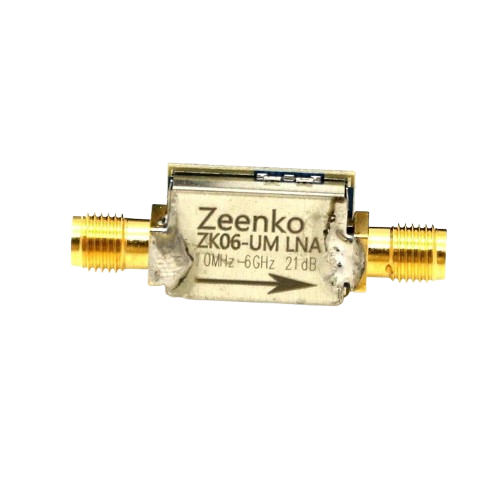
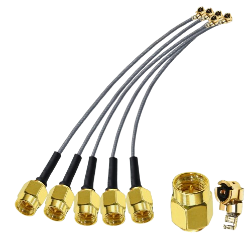

<div align="center">
  

  <p><strong>ESP32-C5 Analog 5.8 GHz FPV Receiver</strong></p>
  <p>From live 5.8 GHz FPV video to real-time analog CVBS with one Seeed Studio XIAO ESP32-C5 and a passive resistor DAC.</p>

  <p>
    <a href="https://twotoz.github.io/C5VRX/"></a>
    <a href="https://discord.gg/3YNgJRHmzD"></a>
    <a href="https://www.youtube.com/watch?v=Gp3xmLrn_34"></a>
    
    
    
    
    
  </p>

  <p>
    
    
  </p>
</div>

---

C5VRX-5 receives analog 5.8 GHz FPV video with the ESP32-C5's own radio and
outputs composite PAL/NTSC through a passive 6-bit resistor DAC: automatic
gain control, a quick baseline boot with manual calibration, an on-screen
menu, and browser-based flashing and controls.

The default demodulator is **D32-R2** (2026-11-15): the phase difference of
successive samples in 32 sectors, with click suppression for steps no video
carrier can make. On a board capture it left 41 % less colour noise (the
coloured dots) than U50P64-R1, confirmed on the goggle; in the host model it
holds the picture about as long as U50P64-R1 for a VTX of deviation ~0.7 and
longer for wide VTXs, with a grainier luma just above the edge. **U50P64-R1**
(loop gain 0.50) and **U80P64-R1** ([evidence and limits](docs/P64.md)) stay
selectable. D32-R2's range is host-modelled only; a walk against U50P64-R1
is still needed. Board findings, including the retired U85Q/kp/LP models
and the removed sync flywheel, are in [docs/FINDINGS.md](docs/FINDINGS.md).

## Experimental firmware — flight safety warning

> [!WARNING]
> **C5VRX is an experimental FPV receiver. Bugs, signal loss, automatic
> receive-chain changes or incompatibility with your camera/goggles can cause
> sudden loss of video or sync, even after an apparently successful test.
> Loss of FPV video can lead to a crash, property damage or serious injury.**
> Do not rely on C5VRX as your only means of maintaining safe control of an aircraft.

- **Test every firmware, hardware and settings combination on the ground
  first**, propellers removed: startup, calibration, weak signal, recovery
  after video loss, with your own camera and goggles.
- **Keep disruptive actions on the ground.** Calibration, scanning, channel
  changes, the menu, DAC tests and diagnostics can interrupt the picture;
  never flash or run bench tests in flight.
- **Automatic changes are experimental too.** Live filter/profile switching
  (default on; console `A` turns it off, `T` shows the state) and live
  OUTPUT/format changes restart part of the pipeline and may interrupt video.
- **Fly tests in a controlled area** clear of people, traffic and property,
  close by, with a safe way to recover if video disappears, and within local
  rules (visual line of sight, observers).
- **A release, a "Latest" label or green CI is not flight qualification.**
  PR builds are development builds; a test of an earlier build does not
  validate later changes.
- **Report video loss** with the exact firmware version, hardware, settings,
  steps and any logs/DVR footage, and investigate on the ground before flying
  again.

The firmware is provided under [GPL-3.0-only](LICENSE), including its warranty
and liability provisions in sections 15–17, to the extent permitted by
applicable law. This warning does not replace those terms or limit rights
that cannot legally be excluded.

## Video

[C5VRX-5 vs C5VRX-4 flight range test by Louis Hitchcock](https://www.youtube.com/watch?v=Gp3xmLrn_34).

## Hardware

A Seeed Studio XIAO ESP32-C5 and seven resistors; no extra RF parts
([schematic](docs/hardware/c5vrx-dac-schematic.png)). Six resistors, one per
pin, join on one node, the CVBS output; the seventh loads that node to GND.

| XIAO pin | GPIO | DAC bit | Resistor to the output node |
| --- | ---: | --- | ---: |
| D4 | 23 | bit 0 (LSB) | 8.2 kΩ |
| D5 | 24 | bit 1 | 3.9 kΩ |
| D6 | 11 | bit 2 | 2.0 kΩ |
| D7 | 12 | bit 3 | 1.0 kΩ |
| D8 | 8 | bit 4 | 470 Ω |
| D9 | 9 | bit 5 (MSB) | 240 Ω |
| GND | - | load | 200 Ω (output node to GND) |

```
D4 --[8.2k]--+
D5 --[3.9k]--+
D6 --[2.0k]--+
D7 --[1.0k]--+-----------> CVBS out (goggle / monitor AV-in, video)
D8 --[470R]--+     |
D9 --[240R]--+   [200R]   (optional: 470 pF from the node to GND,
                   |        improvement unproven)
GND ---------------+------> GND (goggle / monitor AV-in ground)
```

- **Pin order matters**: 8.2k on D4, 240R on D9. A swapped pair gives a
  scrambled, banded picture.
- Connect the node to the video input (tip) of the goggles, DVR or monitor,
  with a common ground. Standard E24 1 % resistors are fine; keep the wires
  short. Power comes over USB-C or the 5 V pin.
- The video level is **OUTPUT** in the menu (0.5–5.0x, saved; high levels
  can clip). EXPERIMENTAL > AUTO OUTPUT (off by default) lets it follow the
  VTX while OUTPUT is 1.0x; every change it makes is a short (~5 ms) video
  restart.
- **Check the build with the DAC self-test** (`Z` or menu DAC TEST) before
  chasing picture problems: see
  [Building and testing the resistor DAC](docs/hardware/dac-build-and-test.md).

IQ routing is internal (no wiring) and uses GPIO27 (the user LED, which may
glow) and GPIO2. The planned seven/eight-bit DAC expansion is cancelled;
firmware stays six-bit. Leave the carrier's optional R8/R9 unpopulated and
SJ2/SJ3 open.

### Optional external LNA (more range)

C5VRX-5 now supports an external low-noise amplifier in front of the
XIAO. Tested with the **Zeenko ZK06-UM** (10 MHz–6 GHz, SMA;
datasheet at 5.8 GHz: ~22.6 dB gain, ~1.0 dB noise figure), listed under
[Build components](#build-components).

- **Wiring:** antenna → LNA input → LNA output → IPX (U.FL) to SMA pigtail
  → the XIAO's IPX antenna connector (both listed under
  [Build components](#build-components)). Mind the arrow on the LNA: it
  points from the antenna to the receiver. Keep the antenna-to-LNA cable as
  short as possible: every dB lost before the LNA is lost range. Power the
  LNA as its seller specifies.
- **No setting needed.** The firmware measures its own receiver noise and
  follows it: the gain stops where the LNA's noise would fold the 4-bit IQ
  (about G67 with this LNA, G83 without), and the noise reference, signal
  meter, AGC and live DC model adapt by themselves. Fitting or removing the
  LNA needs no calibration. Let the receiver see a few seconds without a
  VTX on its channel after the first boot with a new front end.
- **What it gives:** the receiver's noise figure drops from ~6 dB to ~1 dB.
  In a first indoor walk (a small house, rooms and cupboards) the picture
  held to about **6.5 dB weaker signals** than the bare receiver on the
  previous firmware (50 % picture near −93 dBm at the antenna against
  −86.5 dBm). How much distance that is depends on the surroundings: about
  1.5–1.7× in built-up areas, more in open space; an outdoor A/B is still to
  come.
- **Close in** the LNA's extra gain uses up the lowest gain rows sooner;
  STRONG LANE (EXPERIMENTAL, on by default) takes over when even the lowest
  row folds. EXPERIMENTAL > LEVEL TOP (9 default; 6 / 12 / 16) sets how much
  noise the top gain row may carry.

Details and measurements: [docs/FINDINGS.md](docs/FINDINGS.md), "Received
level at the chip pin" and the external LNA notes.

### Optional digital video capture: Clock Pin D10

In **EXPERIMENTAL**, set **Clock Pin D10** to **ON**, then power off and
move the existing **bit 2 / 2.0 kohm branch from D6/GPIO11 to D3/GPIO7**.
On the next boot, D10/GPIO10 exports the **40 MHz PARLIO TX clock**, and
bit 2 uses D3. OFF is the default and retains the original D4-D9 wiring;
turning it off also needs a reboot and moving the branch back. The menu
shows a reboot warning until the requested setting matches the active one.
The ordinary PR firmware includes this option; no custom build is needed.

For FPGA capture, tap the data pins **before the resistors**, use 3.3 V
inputs and a common ground. With the option active, bit order low to high is
D4, D5, **D3**, D7, D8, D9. D6 is disconnected from TX. Data shifts on
falling clock edges; capture on rising edges and verify timing on your board.
The bus is still six-bit composite video: live samples are identical pairs
`[D,D]` at TX40, **20 MS/s unique codes**. The original colour burst is
preserved; the external device owns sync recovery and colour decoding.
Menu/startup rasters also use this bus. Halted TX/restarts can interrupt the
clock and video; the capture device must reacquire. Console **T** reports
`SAMPLE_CLOCK` with active/requested state, pin, rate and DAC-bit-2 pin.

This extends [LAP87's capture tests](https://github.com/Twotoz/C5VRX/issues/256#issuecomment-6530295384).
The GPIO11 bit-2 rising-edge delay reported there (25 ns) motivates the D3
route; a timing fix on D3 is **not yet verified**. GPIO2 remains IQ-owned.
DAC TEST labels bit 2 as D3 when active; in `tools/dac_check.py`, enter
that branch's measurement using the existing `--d6` argument.
USB DTR/RTS can trigger the ESP32-C5 USB-Serial-JTAG reset/boot behaviour;
there is no deliberate host-DTR gate in the video stream.

### DIY Carrier PCB — REV C: Fat Shark Module + 3.5 mm AV Jack

**[C5VRX_JACK_DIY_V3 / REV C](hardware/C5VRX_JACK_DIY_V3)** is the latest proposed DIY carrier revision for the Seeed Studio XIAO ESP32-C5. It keeps the REV B layout (Fat Shark module-bay outline, 3.5 mm PJ-320D AV jack, reserved seventh/eighth DAC branches) and replaces the SJ1 bay-power solder bridge with a through-hole 1N5819 Schottky diode, so USB and the goggle bay can be connected at the same time.

<div align="center">
  
  
</div>

| Feature | REV C details |
| --- | --- |
| **Form factor** | 42.51 × 28.80 mm; XIAO, AV jack and bay header keep their REV A positions |
| **AV output** | VIDEO on Fat Shark J1 pin 6 and PJ-320D tip + ring 1; ground on the jack sleeve |
| **Through-hole DAC** | DIN0207 axial ¼ W resistors; existing six branches and 200 Ω shunt retained |
| **Reserved DAC expansion** | R8: 15 kΩ from D10/GPIO10 via SJ2; R9: 33 kΩ from D3/GPIO7 via SJ3 |
| **Bay power** | D1: 1N5819 Schottky (DO-41, through-hole) from bay 5 V to XIAO 5 V; no jumper to open before USB programming |
| **Rear solder jumpers** | SJ2 / BIT 7 and SJ3 / BIT 8: extra DAC branches |
| **Artwork** | C5VRX logos on both sides; REV C and 6–8 BIT DAC markings on the back |

**Current firmware remains six-bit:** leave R8/R9 unpopulated and SJ2/SJ3 open. The old expansion footprints are retained in the PCB artwork only; seven/eight-bit firmware support is cancelled. Use the rewiring above for Clock Pin D10. [Assembly and jumper settings](hardware/C5VRX_JACK_DIY_V3#dac-branches-and-rear-jumpers).

**Downloads:** [Gerbers + drills](hardware/C5VRX_JACK_DIY_V3/exports/C5VRX_JACK_DIY_V3-gerbers.zip) · [KiCad project](hardware/C5VRX_JACK_DIY_V3) · [BOM](hardware/C5VRX_JACK_DIY_V3/BOM.csv) · [Schematic PDF](hardware/C5VRX_JACK_DIY_V3/exports/C5VRX_JACK_DIY_V3-schematic.pdf) · [STEP](hardware/C5VRX_JACK_DIY_V3/exports/C5VRX_JACK_DIY_V3.step) · [Renders](hardware/C5VRX_JACK_DIY_V3/exports/renders/).

KiCad ERC/DRC and schematic/PCB parity checks are clean; REV C has not been built or measured. [REV B](hardware/C5VRX_JACK_DIY_V2) and the original [REV A carrier](hardware/C5VRX_JACK_DIY) remain available with their fabrication files.

## Flashing

- **Browser:** open the [web flasher](https://twotoz.github.io/C5VRX/) in
  desktop Chrome or Edge, choose **C5VRX-5** and a build, and flash. Use
  **Full firmware** when coming from another generation. **Local File**
  flashes your own `.bin`; **Legacy builds** holds archived C5VRX-3 firmware.
- **From source:** ESP-IDF **6.0.2** (filter and DC correction need its exact
  libphy; other versions build with them disabled and a warning):

  ```sh
  idf.py build
  python tools/flash.py PORT          # e.g. COM6 or /dev/ttyACM0
  ```

  Do not use `idf.py flash` on a running receiver: its USB line reset hangs
  the board until USB and battery are removed. `tools/flash.py` enters
  download mode through the firmware instead. Useful options: `--app-only`,
  `--monitor` / `--monitor-only`, `--log FILE`, `--iq DIR` (IQ snapshots),
  `--check` (boot, `T` and `D`; fails on a crash, wrong image or chain
  fault), `--no-key` (board already in the ROM loader). After
  `sdkconfig.defaults` changes, delete `sdkconfig` and rebuild.
- **XIAO ESP32-C5HR8 with 8 MB PSRAM** (optional; the standard image also
  runs without PSRAM, this one panics without it):

  ```sh
  idf.py -B build-psram -DSDKCONFIG=sdkconfig.psram "-DSDKCONFIG_DEFAULTS=sdkconfig.defaults;sdkconfig.psram.defaults" build
  python tools/flash.py PORT --build build-psram --check
  ```

  Flash the full image when switching. Boot `heap_min` rose from ~2.1 KB to
  ~21.9 KB; PAL and long runs are pending
  ([measurements](docs/FINDINGS.md#psram-8-mb-on-the-xiao-now-mapped-board-2026-10-26)).
- **FireBeetle 2 ESP32-C5 + ESP32-P4 display** (the C5 receives as on the
  XIAO; its DAC codes, clock and a UART go to a Guition JC1060P470C, which
  shows the picture on its 1024 x 600 touch LCD with a settings column and
  streams it as a USB webcam; builds only, not yet board-checked):

  ```sh
  idf.py -B build-p4link -DSDKCONFIG=sdkconfig.p4link "-DSDKCONFIG_DEFAULTS=sdkconfig.defaults;sdkconfig.p4link.defaults" build
  python tools/flash.py PORT --build build-p4link
  cd p4 && idf.py build flash   # ESP-IDF 5.5, the P4 side
  ```

  Wiring and details: [docs/P4LINK.md](docs/P4LINK.md).

## First boot

1. The receiver loads saved settings or a fixed baseline; a short
   sampling-phase check runs under the boot logo. There is no automatic
   RF/DC sweep.
2. If repeated measurements show a poor baseline, the menu recommends
   **CALIBRATE**: run it on the ground, preferably with the VTX off. Full RF
   optimization (`B` / web controls) is a separate, longer bench operation.
3. Select the VTX channel or use SCAN (A1 without a saved channel).
4. **CALIBRATE → Download calibration report** in the web controls exports
   read-only board data ([protocol](docs/FASTER_CALIBRATION.md)).

## Controls

**BOOT button:** short press = next channel (menu: next item); hold 0.6 s =
open the menu (menu: select).

**Menu**, one list with every value in view: BAND, CHANNEL, SCAN, VIDEO
(AUTO/NTSC/PAL), FILTER (AUTO/XNARROW/NARROW/NORMAL/WIDE), PHY FILT
(digital filter mode), AFC (ON/OFF), CALIBRATE, OUTPUT (0.5–5.0x), GAIN
(LEVEL/KEEL/RSSI/MAX/fixed), DEMOD (P64/U85Q/U50/D32), DAC TEST, EXIT. It closes after 30 s of
inactivity (5 min in DAC TEST); entering and leaving can interrupt video.
GAIN defaults to **LEVEL**; KEEL and RSSI are kept for comparison
([AGC research](docs/FINDINGS.md)). The automatic models are remembered
across reboots; MAX and fixed gains never are.

**Serial console** (web flasher **Terminal** tab, or 115200 baud): keys are
case-sensitive, without Enter; `h` lists what your firmware supports.

| Key | Action |
| --- | --- |
| `T` / `h` | Status / help |
| `b` / `c` / `s` | Next band / next channel / scan |
| `o` / `n` / `x` / `e` | Open menu / next item / select / exit |
| `v` / `g` / `G` | Video standard / output level / gain |
| `F` / `B` / `C` | Calibrate current filter / full RF optimization / read-only calibration report |
| `Z` | DAC self-test (ground only) |
| `D` / `R` | Health report / per-second field diagnostics |
| `I` / `M` / `L` | IQ snapshot / gain map / bench IQ lane test |
| `A` | Live filter/profile switching on/off (saved) |
| `S` + suite | Bench PHY sensitivity lab, VTX on ([docs](docs/PHY_SENSITIVITY_LAB.md); ground only) |
| `` ` `` | USB download mode |

Live OUTPUT and profile changes share a five-second cooldown and a verified
restart with rollback. The browser terminal and the flasher use the port one
at a time; **Download log** saves the last 120,000 characters.

## Documentation and development

- [DAC build and self-test](docs/hardware/dac-build-and-test.md) ·
  carriers [REV C](hardware/C5VRX_JACK_DIY_V3), [REV B](hardware/C5VRX_JACK_DIY_V2), [REV A](hardware/C5VRX_JACK_DIY)
- [Receiver findings and hardware evidence](docs/FINDINGS.md) ·
  [field-test protocol](docs/FIELD_TEST.md) ·
  [current receiver behaviour](docs/PR212.md)
- [Research ledger](docs/RESEARCH_LEDGER.md) · [research index](research/README.md) ·
  [U85Q research](docs/pr190-key-findings.md) · [contributing](CONTRIBUTING.md)

`main/` is the C5VRX-5 firmware, `web/` the flasher, `test/` host tests,
`docs/` guides and findings, `research/` experiments, `tools/` console and CI
helpers; `legacy/` keeps C5VRX-1 to C5VRX-4 for reference (not built).

CI runs the host and research checks, builds with ESP-IDF 6.0.2 and publishes
`c5vrx5-v5.0.N` releases from `main` and `c5vrx5-pr-N` builds for PRs;
website-only changes create no firmware. Firmware PRs need board tests on the
matching build: host tests do not establish picture compatibility or range.

## Community

Share build photos, questions and feedback on the
[C5VRX Discord](https://discord.gg/3YNgJRHmzD).

## Credits and license

C5VRX-5 is part of [C5VRX](https://github.com/Twotoz/C5VRX) by Twotoz and
the C5VRX contributors; the official website
([twotoz.github.io/C5VRX](https://twotoz.github.io/C5VRX/)) has the project
and its Discord invite. It builds on C5VRX-2..4 (the continuous MODEM_DIAG
to BitScrambler video path, Direct Gain V3-V5, the PAIR schedule and the
U85Q study of PR #190), on zerowidth/C5VRX PR #3 (interference-burst gate,
sampling-phase probe, off-grid channel tuning), on Louis Hitchcock's staged
overload recovery (C5VRX #182/#184), and on ESPARGOS esp-sdr (GPL-3.0) for
the C5 RX filter control. Espressif supplied the GDMA EOF fix
(espressif/esp-idf#19091).

Like the rest of this repository, C5VRX-5 is licensed under
**GPL-3.0-only** (see [LICENSE](LICENSE)). The GPL allows
commercial use, including selling receivers with this firmware, provided
the source (with your changes) is passed on under the same license.

The C5VRX name and logos have separate terms; see [assets/BRANDING.md](assets/BRANDING.md).

## Build components

| Product | Photo | Link / Source |
| --- | --- | --- |
| Seeed Studio XIAO ESP32-C5 |  | [View on Amazon](https://link.amazon/B0gopCVDt) |
| C5VRX_JACK_DIY_V3 / REV C carrier |  | [Gerbers & KiCad files](hardware/C5VRX_JACK_DIY_V3) · [REV B](hardware/C5VRX_JACK_DIY_V2) · [REV A](hardware/C5VRX_JACK_DIY) |
| Perfboard (alternative) |  | [View on Amazon](https://link.amazon/B0i2qqMeq) |
| Resistor kit |  | [View on Amazon](https://link.amazon/B06XSBkln) |
| Zeenko ZK06-UM LNA (optional, [more range](#optional-external-lna-more-range)) |  | [View on Amazon](https://link.amazon/B0iY2ccnV) |
| IPX (U.FL) to SMA pigtail (XIAO to the LNA) |  | [View on Amazon](https://link.amazon/B07pMkNyf) |

Affiliate links. As an Amazon Associate, I earn from qualifying purchases.
All affiliate earnings go back into C5VRX development.

